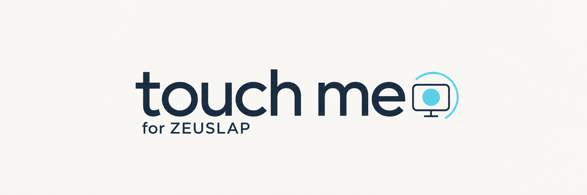

[English](README.md) · [한국어](README.ko.md) · [Source](https://github.com/soom-kang/touch-me)

# Touch Me Homebrew Tap

Touch Me는 Mac에서 ZEUSLAP 터치 모니터의 입력을 제대로 활용하도록 돕는 메뉴 막대 앱입니다. 이 저장소는 Touch Me beta를 Homebrew로 설치하고 업데이트할 수 있도록 제공하는 개인 Tap으로, 배포 버전·다운로드 주소·파일 검증 정보를 관리합니다.

현재 beta는 Apple Silicon Mac과 macOS 26(Tahoe) 이상을 대상으로 하며, P16KT에서 확인한 USB/HID profile이 필요합니다. 다른 ZEUSLAP 모델의 호환성은 확인되지 않았습니다. 기본 언어는 영어이며 설정에서 한국어로 바꿀 수 있습니다.

## Beta.10 공개 — 2026-10-14

[Beta.10 prerelease](https://github.com/soom-kang/touch-me/releases/tag/v0.8.0-beta.10)의 상태는 **PUBLISHED**이며, 공개 시각은 2026-10-14 01:14:28 KST / 2026-10-13 16:14:28 UTC입니다. Source `main`과 tag `v0.8.0-beta.10`가 가리키는 commit은 `8aaebe4530ece3e0b6309c3be0df3c2d57e4d07f`이며 annotated tag object는 `51db567d54bd80987d5375a91e55cd80ba7f0f50`입니다.

Native 앱과 DMG를 각각 한 번 생성해 고정한 인증서로 서명한 `0.8.0-beta.10` release, build 28을 만들었습니다. Native 앱 검증은 **NATIVE_APP_PASS**입니다. Strict 서명과 정확한 인증서를 확인했고 designated requirement는 beta.9와 양방향으로 일치하며 code hash는 다릅니다.

익명으로 받은 public DMG와 checksum sidecar는 동결한 후보와 전체 bytes, 크기와 digest가 일치해 **PUBLIC_DOWNLOAD_PASS**입니다. Public bytes와 source/tag를 함께 확인한 검증 기록의 결과는 **PUBLIC_BYTE_AND_TAG_PASS**입니다. 확인한 public DMG checksum을 이 Cask에 반영했습니다. Beta.10 설치는 **NOT_RUN**입니다.

| 공개 beta.10 release | 확인한 값 |
| --- | --- |
| Version / build | `0.8.0-beta.10` / 28 |
| DMG | `touch-me-0.8.0-beta.10-arm64.dmg`, 525,357 bytes |
| DMG SHA-256 | `106e1738dd514f5f1ee32c912b07dea721f84cf37a8965f5474f511492d2121b` |
| Signing certificate SHA-1 | `e7491a0b49d0784093d48b2bb30b298df3a924f9` |
| Signing certificate SHA-256 | `f58a3ca4f6dcfda8f04192c5170288b3a5ffb286acbcae147ead120892002819` |

Ad hoc beta.8 → 인증서 서명 beta.9 전환은 완료했습니다. 설치된 beta.9 A 앱의 자체 GUI에서 **입력 모니터링: 허용**, **손쉬운 사용: 허용**을 사용자가 확인했습니다(**USER_REPORTED**). 정상 종료 후 native process 검사에서도 Touch Me process가 없었습니다. A의 기준 상태를 확인했으며 공개 beta.9 A → beta.10 B의 Homebrew upgrade와 권한 유지 검증은 **NOT_RUN**입니다. Beta.10 GUI·실기기 동작, Gatekeeper와 서명 identity나 추가 인증서 신뢰가 없는 Mac에서의 사용도 **NOT_RUN**입니다.

Beta.10 Cask의 Ruby syntax는 PASS입니다. 설치된 호환 `spoom 1.8.9`를 process-only `-I` 경로로 불러와 동등한 Homebrew style 규칙 검사를 통과했습니다. 검사한 파일은 1개이며 offenses는 없었습니다. 추가 cop 제외나 gem 설치는 없었고 설정 파일과 trust 저장소는 수정하지 않았습니다. Bundle이 참조하는 `spoom 1.8.10`이 없는 기존 불일치는 유지됩니다. Lockfile의 정확한 toolchain을 검증한 결과는 아닙니다.

이 개인 Tap의 시험 배포는 Developer ID 서명이나 Apple 공증을 제공하지 않습니다. Cask에는 권한 부여, 인증서 신뢰 변경이나 quarantine 제거 hook이 없습니다. 선택한 Cask의 trust 범위를 유지합니다. 일반 online audit는 기존 보류에 따라 **BLOCKED**입니다.

## Beta.9 공개 기록 — 2026-10-14

[Beta.9 prerelease](https://github.com/soom-kang/touch-me/releases/tag/v0.8.0-beta.9)는 2026-10-14 00:17:31 KST / 2026-10-13 15:17:31 UTC에 공개했습니다(**PUBLISHED**). 당시 source `main`과 tag `v0.8.0-beta.9`가 가리킨 commit은 `0414617c860451e0c7b2200294b0eeca651f9ad9`입니다.

Native 앱과 DMG를 각각 한 번 생성해 고정한 maintainer 인증서로 서명한 build 27을 만들었고 산출물 검증을 통과했습니다. 익명으로 받은 public DMG와 checksum sidecar는 동결한 후보와 전체 bytes, 크기와 digest가 일치해 **PUBLIC_DOWNLOAD_PASS**입니다. 확인한 DMG checksum을 beta.9 Cask에 반영했습니다. 이전 release, asset과 tag reference의 기록된 식별을 유지했습니다.

| 공개 beta.9 release | 확인한 값 |
| --- | --- |
| Version / build | `0.8.0-beta.9` / 27 |
| DMG | `touch-me-0.8.0-beta.9-arm64.dmg`, 525,433 bytes |
| DMG SHA-256 | `1ef60494e4191437493f3941dba096fcc514d916b28f8380c6a71e1a579b27db` |
| Signing certificate SHA-1 | `e7491a0b49d0784093d48b2bb30b298df3a924f9` |
| Signing certificate SHA-256 | `f58a3ca4f6dcfda8f04192c5170288b3a5ffb286acbcae147ead120892002819` |

합의한 검증 경로는 같은 인증서와 앱 target을 사용한 공개 signed beta.9 A → beta.10 B의 정상 Homebrew upgrade입니다. Ad hoc beta.8에서 처음 전환할 때는 개인정보 보호 권한을 수동으로 다시 허용해야 할 수 있습니다. 공개 당시 beta.9 설치, Homebrew upgrade, GUI·실기기 동작, Gatekeeper, 서명 identity나 추가 인증서 신뢰가 없는 Mac에서의 사용과 signed A → B 권한 유지 검증은 **NOT_RUN**이었습니다. 이후 사용자가 확인한 A의 기준 상태는 위에 기록했습니다. Public 산출물 검증만으로 acceptance 성공을 판단하지 않습니다. 이 개인 Tap의 시험 배포는 Developer ID 서명이나 Apple 공증을 제공하지 않습니다.

실제 beta.9 Cask의 Ruby syntax는 PASS입니다. 설치된 호환 `spoom 1.8.9`를 process-only `-I` 경로로 불러와 동등한 Homebrew style 규칙 검사를 통과했습니다. 검사한 파일은 1개이며 offenses는 없었습니다. 추가 cop 제외나 gem 설치는 없었고 설정 파일과 trust 저장소는 수정하지 않았습니다. Bundle이 참조하는 `spoom 1.8.10`이 없어 최초 실행은 exit 2로 중단됐으며, 두 실행 기록과 불일치 내용을 로그에 보존했습니다. Lockfile의 정확한 toolchain을 검증한 결과는 아닙니다.

Cask에는 권한 부여, 인증서 신뢰 변경이나 quarantine 제거 hook이 없습니다. 선택한 Cask의 trust 범위를 유지합니다. 일반 online audit는 기존 보류에 따라 **BLOCKED**입니다. Audit를 실행하려고 developer mode를 켜거나 gem, trust 설정을 바꾸지 않습니다.

## Beta.8 공개 기록 — 2026-10-12

아래 내용은 beta.8 공개 checkpoint를 보존한 기록입니다. 산출물과 acceptance 결과를 beta.9 release의 검증으로 취급하지 않습니다.

Beta.8/build 26에는 QA 수정 두 건이 포함됩니다.

- **TMQA-006:** Active recovery record가 없어도 Retry와 Start는 directory sync를 확인합니다. Sync 오류나 새 기록이 있으면 Start를 차단하며 기록 형식과 장치 feature I/O는 유지합니다.
- **TMQA-007:** 최종 파일을 바꾸기 전에 DMG와 checksum을 함께 준비합니다. 유효한 이전 쌍은 원래 파일명으로 보관하고 일반 파일 이동 오류는 되돌립니다. 기존 쌍 중 한 파일만 없거나 checksum이 맞지 않으면 보존하고 중단합니다. 두 파일이 모두 없으면 첫 패키징을 허용합니다. Rollback도 실패하면 추가 이동을 멈추고 복구 경로를 표시합니다. 개별 rename은 crash, 전원 손실이나 동시 실행까지 atomicity를 보장하지 않습니다.

Beta.7에서 추가한 USB-C 재연결 처리는 유지합니다. 앱을 계속 실행한 상태에서 새 연결의 현재 값이 `(0,0)`이고 저장한 USB location과 화면이 일치하면 권한, 장치와 화면 안전 검사를 거쳐 매핑을 자동으로 재개합니다. 현재 값이 `(2,0)`이면 안내를 확인한 뒤 직접 **매핑 시작**을 눌러야 하며 **매핑 중지** 후에도 그 값을 유지합니다.

이전 기록은 같은 boot에서 기록된 HID/USB service가 모두 종료됐고 소유권이 확인된 경우에만 archive로 보존합니다. Archive는 원래 모드 복구를 확인한 결과가 아니며 그 값을 새 연결에 쓰도록 허용하지 않습니다. 불확실한 기록은 매핑을 차단하므로 보존한 채 **복구 재시도**를 사용하세요.

당시 이 Tap은 검증한 [beta.8 prerelease](https://github.com/soom-kang/touch-me/releases/tag/v0.8.0-beta.8), build 26을 배포했습니다. Source/tag 식별과 익명으로 받은 public DMG/checksum sidecar의 bytes, 크기와 digest가 동결한 후보와 일치했습니다. 실제 Cask Ruby syntax와 동등한 Homebrew style 규칙 검사는 통과했습니다. Tap 폴더에서 실행한 style 검사는 파일 한 개에서 offenses가 없었으며 실제 Cask는 초안 header 주석 두 줄을 제외한 source 본문과 일치했습니다.

| 공개 release 식별 | 확인한 값 |
| --- | --- |
| 공개 시각 | 2026-10-12 10:41:21 KST / 01:41:21 UTC |
| Source / tag commit | `e97d1720e2e994761614935cb04303f05fd1c691` / `v0.8.0-beta.8` |
| Annotated tag object | `054ca99a7936c1d6f27e6f788f303b34f0a343ca` |
| Version / build / DMG | `0.8.0-beta.8` / 26; `touch-me-0.8.0-beta.8-arm64.dmg`, 525,223 bytes |
| DMG SHA-256 | `d5b2b99085893a781928fbb7f8793e6c88505d05c32394c75c2ad57a9c7d8fb1` |

Runtime/test source가 유지돼 Swift tests 38개와 packaging tests 22개의 PASS를 재사용합니다. 새 앱과 DMG를 각각 한 번 만들었고 strict ad hoc 서명, metadata/라이선스/아이콘, arm64, 이미지 무결성/sidecar, 읽기 전용 내부 앱 bytes와 정상 detach 검사를 통과했습니다. Build 26 GUI, 실기기 동작, 설치, upgrade와 다운로드한 앱의 첫 실행 Gatekeeper는 `NOT_RUN`입니다.

일반 online audit는 승인한 보류에 따라 `BLOCKED`입니다. 2026-10-12 preflight에서 선택한 Cask는 trusted, Tap 전체는 untrusted였으며 두 상태를 유지합니다. Style 검증에는 설치된 vendored RuboCop wrapper의 동등한 Homebrew 규칙과 별도 cache를 사용합니다. `brew style` front-end, gem 설치/정리와 trust 변경 명령은 이번 검증에 포함하지 않습니다.

이전 release 7개, asset 14개와 annotated/peeled tag reference 14개의 식별은 그대로입니다. [Beta.7 공개](https://github.com/soom-kang/touch-me/releases/tag/v0.8.0-beta.7)와 당시 trust 관련 audit 보류는 과거 근거로 보존합니다. 개발 build 24의 재연결 한 차례는 사용자 보고이며 직접 device-mode readback은 없었습니다. Build 26 acceptance로 취급하지 않습니다. [Beta.5/build 23 native acceptance](https://github.com/soom-kang/touch-me/blob/main/docs/qa/beta5-native-acceptance.md)와 [beta.6 release 기록](https://github.com/soom-kang/touch-me/releases/tag/v0.8.0-beta.6)도 원래 범위를 유지합니다.

드래그 시작 전에 두 번째 손가락이 감지되면 대기 중인 클릭을 취소합니다. 한 손가락 탭은 손을 뗄 때 클릭하며, 화면 좌표 8단위를 초과해 이동하면 드래그를 시작합니다. 진행 중인 드래그는 처음 손가락을 따라갑니다. 제스처를 바꾸거나 스크롤 뒤 다시 시작하려면 손가락을 모두 떼세요. 변경 사항과 검증 한계는 [release notes](https://github.com/soom-kang/touch-me/releases/tag/v0.8.0-beta.8)를 확인하세요.

## 설치

이 Cask는 검증한 public beta.10 prerelease를 대상으로 합니다. 설치나 업데이트 전에 로컬 Cask의 버전이 `0.8.0-beta.10`인지, 해당 버전의 release URL과 위 표의 SHA-256을 사용하는지 확인하세요. Public 산출물 검증은 로컬 설치나 upgrade 성공의 근거가 되지 않습니다.

`/Applications/Touch Me.app`을 수동으로 설치했다면 **로그인 시작**을 끄고 **매핑 중지**를 선택하세요. 대기 중인 복구나 기록 처리를 완료한 뒤 정상 **종료**합니다. 기존 앱을 Applications 밖에 보존한 다음 설치를 진행하세요. 저장한 환경설정과 recovery record는 유지하고 강제로 덮어쓰지 않습니다.

```bash
brew install --cask soom-kang/touch-me/touch-me
```

Beta.10 release는 beta.9와 같은 고정 maintainer 인증서로 서명했으며 Developer ID나 Apple 공증을 제공하지 않습니다. 첫 실행 전에 공개한 정확한 버전의 source와 checksum을 확인하세요. macOS가 실행을 차단할 수 있습니다. 승인 경로가 제공되면 **시스템 설정 → 개인정보 보호 및 보안 → 확인 없이 열기**에서 [Apple의 수동 승인 절차](https://support.apple.com/en-us/102445)를 따릅니다. 손상·악성 소프트웨어 경고나 관리 정책이 있다면 원인을 확인해야 합니다. 승인과 실행을 보장하지 않습니다.

시스템 설정에서 **입력 모니터링**과 **손쉬운 사용**을 허용한 뒤 앱을 새로 고침하세요. Ad hoc 서명에서 처음 전환할 때는 수동 재승인이 필요할 수 있습니다. 이미 허용된 권한은 유지하고 매핑 전에 두 권한을 확인하세요. Signed beta.9 → beta.10의 권한 유지 검증은 아직 `NOT_RUN`입니다. Cask는 권한을 부여하거나 인증서 신뢰 설정을 바꾸지 않습니다.

## 업데이트·제거

두 작업 모두 **매핑 중지**, 대기 중인 복구나 기록 처리 완료, 정상 **종료** 순서로 준비합니다. 복구나 기록 처리가 실패하면 작업을 중단하고 **복구 재시도**를 누르세요. Recovery record는 보존하며 업그레이드나 제거를 진행하기 위해 삭제하지 않습니다. 같은 USB 포트에 다시 연결해도 이전 모드를 새 연결에 쓰도록 허용하지 않습니다.

업데이트 전에 `brew`를 실행할 앱의 **앱 관리(App Management)** 권한을 확인하세요. 이 권한이 있으면 Homebrew가 바깥 앱 폴더를 유지할 수 있습니다. 폴더를 삭제한 뒤 다시 설치하면 권한 정보가 사라질 수 있습니다. 이름을 지정한 정상 upgrade를 사용합니다. 합의한 beta.9 → beta.10 시험에서는 개인정보 보호 권한을 다시 허용하지 않고 새로 실행한 앱을 확인합니다. [Homebrew FAQ](https://docs.brew.sh/FAQ#why-do-my-cask-apps-lose-their-dock-position--launchpad-position--permission-settings-when-i-run-brew-upgrade)

```bash
brew update
brew upgrade --cask soom-kang/touch-me/touch-me
```

제거할 때는 **로그인 시작**을 먼저 끄고 같은 중지·종료 절차를 완료한 뒤 실행합니다.

```bash
brew uninstall --cask soom-kang/touch-me/touch-me
```

제거 후에도 저장한 환경설정과 recovery record는 유지됩니다. 자동 실행, process 종료, 권한 변경 hooks와 `zap`은 제공하지 않습니다.

## Tap 관리

Beta 버전은 수동으로 갱신합니다. Cask의 버전, 버전별 release URL과 SHA-256을 함께 관리하세요. `audit_exceptions/github_prerelease_allowlist.json`에는 배포하려는 정확한 beta 버전을 기록합니다. 해당 prerelease만 허용하고 다른 일반 audit 검사는 유지합니다.

게시와 audit은 [release runbook](https://github.com/soom-kang/touch-me/blob/main/docs/Homebrew.ko.md)을 따릅니다. Audit 결과는 설치, Gatekeeper 승인, GUI 동작, 실기기 매핑이나 로그인 실행의 근거가 되지 않습니다. 사용법과 지원 범위는 [앱 안내](https://github.com/soom-kang/touch-me/blob/main/README.ko.md)를 확인하세요.

[MIT License](LICENSE), copyright 2026 Soom Kang.
